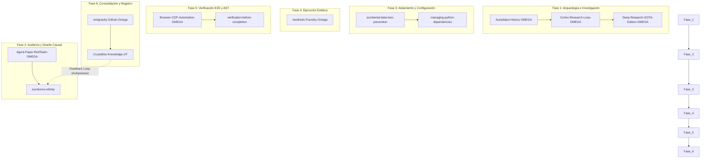

# 🌌 CORTEX-12 Swarm Ignition

Este workflow define el ciclo de vida de desarrollo de software (SDLC) en el ecosistema **MOSKV-1**, integrando sinérgicamente **12 habilidades soberanas OMEGA** para garantizar el Net Yield óptimo ($\Xi \ge 0.85$) en tareas de alta complejidad.

---

## 🛡️ Los 12 Componentes Integrados

| # | Skill | Rol en el Workflow |
|---|---|---|
| 1 | **`Autodidact-History-OMEGA`** | Rastrear el historial causal y las decisiones pasadas en Git para no repetir errores históricos. |
| 2 | **`Cortex-Research-Loop-OMEGA`** | Mapear conceptualmente y realizar consultas ontológicas dentro del grafo de conocimiento local. |
| 3 | **`Deep-Research-SOTA-Edition-OMEGA`** | Investigar el estado del arte técnico, especificaciones de APIs y librerías externas actualizadas a 2026. |
| 4 | **`Agent-Paper-RedTeam-OMEGA`** | Someter la arquitectura propuesta a un análisis destructivo riguroso antes de mutar código. |
| 5 | **`accidental-data-loss-prevention`** | Prevenir el borrado accidental de bases de datos o directorios protegidos por el kernel de seguridad. |
| 6 | **`managing-python-dependencies`** | Instanciar sandboxes aislados y gestionar librerías de dependencias JIT evitando colisiones de entorno. |
| 7 | **`Browser-CDP-Automation-OMEGA`** | Ejecutar automatizaciones de navegador libre de selectores frágiles usando CDP directo. |
| 8 | **`Aesthetic-Foundry-Omega`** | Inyectar el sistema visual en la interfaz bajo la directiva cromática *Industrial Noir 2026*. |
| 9 | **`Antigravity-Github-Omega`** | Sincronizar el repositorio mediante commits atómicos y estructurados sin generar entropía. |
| 10 | **`Crystallize-Knowledge-JIT`** | Extraer lecciones y consolidar la información en nuevos Knowledge Items (KIs). |
| 11 | **`verification-before-completion`** | Forzar la suite de compilación, linters y análisis estático AST antes de dar la tarea por cerrada. |
| 12 | **`ouroboros-infinity`** | Supervisar metacognitivamente la ejecución y reescribir prompts/instrucciones del swarm en tiempo real. |

---

## ⚡ Activación y Disparadores

*   **Comando Directo:** `/swarm-12-ignition` | `/ignite` | `/cortex-12`
*   **Triggers por Voz/Texto:** `"Inicia el enjambre de doce habilidades"`, `"Ignite CORTEX-12 Swarm Pipeline"`, `"Despliega el ciclo completo de ingeniería"`.
*   **Activación Autónoma:** Hito del sistema que requiere la implementación de un subsistema crítico nuevo que involucre persistencia de datos, interfaz de usuario y alta seguridad.

---

## 🔄 Protocolo de Ejecución Paso a Paso

### Paso 1: Inicialización Dimensional (Fase 1)
*   **Comando:** `cortex-12 --phase 1`
*   El sistema invoca a `Autodidact-History-OMEGA` para estudiar los commits recientes. Cruzará los resultados con `Cortex-Research-Loop-OMEGA` y `Deep-Research-SOTA-Edition-OMEGA` para delimitar las asunciones técnicas del proyecto.

### Paso 2: El Matadero Lógico (Fase 2)
*   **Comando:** `cortex-12 --phase 2`
*   La propuesta arquitectónica se entrega a `Agent-Paper-RedTeam-OMEGA` para buscar fallos estructurales. `ouroboros-infinity` actuará como moderador cognitivo, recalculando la entropía estimada.

### Paso 3: Aislamiento e Inmunidad (Fase 3)
*   **Comando:** `cortex-12 --phase 3`
*   `accidental-data-loss-prevention` levanta las paredes del sandbox y `managing-python-dependencies` genera el entorno virtual limpio para la compilación/testeo.

### Paso 4: Síntesis de UI/UX (Fase 4)
*   **Comando:** `cortex-12 --phase 4`
*   Se aplica la inyección del CSS, layouts y modularización WebGL/HTML5 mediante `Aesthetic-Foundry-Omega` bajo la pauta visual mineral y negros absolutos (`#0A0A0A` / `#2B3BE5`).

### Paso 5: Escrutinio Clínico (Fase 5)
*   **Comando:** `cortex-12 --phase 5`
*   `Browser-CDP-Automation-OMEGA` arranca un navegador sin cabecera (headless) para interactuar con la app, y `verification-before-completion` ejecuta las pruebas de estrés sintácticas y semánticas.

### Paso 6: Consolidación del Ledger (Fase 6)
*   **Comando:** `cortex-12 --phase 6`
*   `Antigravity-Github-Omega` registra la mutación exitosa y genera el hash de transacción. Finalmente, `Crystallize-Knowledge-JIT` escribe un nuevo KI documentando las fricciones superadas.

---
*Status: C5-REAL (Persisted to Master Workflows)*
